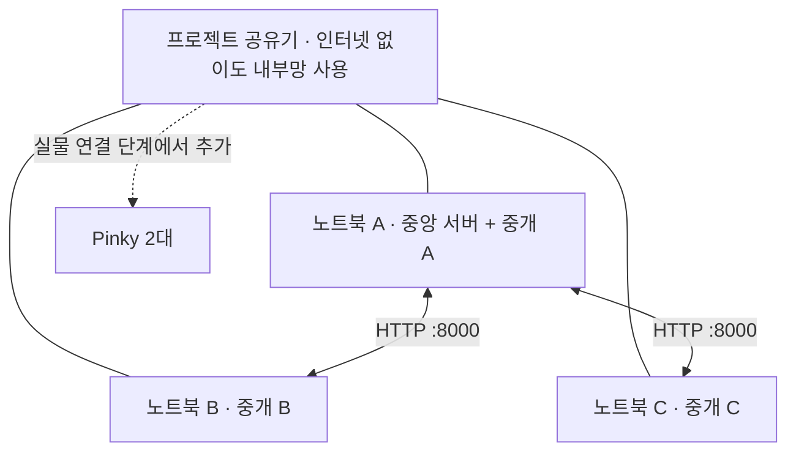

# 카트리나 · 현장 Ubuntu 노트북 3대 세팅

고객 2명의 주문·Pinky 배정·OMX 작업·공유 구역과 적재·인계 결과를 연결한다. 웹은 Vue 3·TypeScript·Vite, 서버는 FastAPI·SQLite다.

**이 PC는 코드 작성용이며, 아래 설치·실행은 현장의 Ubuntu 노트북 A/B/C에서 한다. 현재 실행 모드는 MOCK뿐이다.** 실물 로봇·카메라 없이 노트북 3대 사이의 연결과 작업 흐름부터 확인한다. ROS 2, YOLO, 모방학습, Gazebo·웹 디지털 트윈은 아직 연결하지 않았다. 모의 완료는 실제 장비 성공을 뜻하지 않는다.

설계·요구사항·회의 자료는 [Confluence 요구사항](https://sage0316.atlassian.net/wiki/spaces/MoEAt1HxbH7o/pages/426000/System+Requirements), [시스템 구성](https://sage0316.atlassian.net/wiki/spaces/MoEAt1HxbH7o/pages/164060/System+Architecture), Jira에서 관리한다. 이 파일은 코드와 함께 전달할 실행 안내다.

## 1. 노트북 역할과 준비물

| 구분 | A | B | C |
|---|---|---|---|
| 현재 실행 | 중앙 서버·DB·웹 + 중개 A | 중개 B | 중개 C |
| 논리 장비 | pinky-1, pinky-2, omx-a | omx-b | omx-handoff |
| 추후 실물 연결 | Pinky 2대, 적재 A OMX·카메라 | 적재 B OMX·카메라, 전경 카메라 | 인계 OMX·카메라, 모방학습 추론 |
| Python | 필요 | 필요 | 필요 |
| Node·pnpm·웹 빌드 | 필요 | 불필요 | 불필요 |

준비물: Ubuntu 노트북 3대, 받아둔 프로젝트 공유기·전원, 가능하면 노트북용 랜선·어댑터, 중개 인증 파일 전달용 USB. 첫 모의 시험에는 Pinky·OMX·카메라가 필요 없다.

- [ ] A/B/C 노트북과 담당자를 지정했다.
- [ ] 아래 변경이 팀 저장소에 반영됐고 세 노트북이 받을 브랜치를 확인했다.
- [ ] 공유기에 연결할 방법과 인증 파일 전달용 USB를 준비했다.

**예시 IP:** 이 문서는 A를 `192.168.0.10`, 공유기 내부 대역을 `192.168.0.0/24`로 가정한다. 실제 주소를 확인해 명령·URL의 예시를 바꾼다. 노트북에 이 주소를 임의로 수동 입력하지 않는다.

## 2. 인터넷이 되는 상태에서 공통 준비 — A/B/C 모두

설치·Git clone/pull에는 인터넷이 필요하다. 먼저 학원 Wi-Fi 등 인터넷이 되는 연결에서 코드와 의존성을 준비한다. 이후 프로젝트 공유기로 전환한다. 공유기에 인터넷이 연결돼 있으면 전환 없이 진행해도 된다.

각 노트북의 터미널에서 확인한다.

```bash
cat /etc/os-release
python3 --version
git --version
```

지원 Python은 3.11~3.13이며 Python 3.12를 우선 기준으로 한다. Ubuntu 24.04의 기본 Python은 3.12다. 실제 버전이 범위 밖이면 여기서 멈추고 환경을 확인한다. ROS에 맞춰 설치된 시스템 Python이나 ROS 배포판을 교체하지 않는다.

기본 도구가 없는 경우 해당 노트북에서 설치한다.

```bash
sudo apt update
sudo apt install git python3-venv python3-pip curl
```

아래 두 경로 중 자신의 상태에 맞는 **하나만** 실행한다. 이후 명령은 모두 저장소 폴더에서 실행한다.

공유 저장소는 **https://github.com/rheffi/cartrina-control · Private · main**이다. 비공개 저장소이므로 각 노트북에서 접근 권한이 있는 GitHub 계정 인증이 필요하다. GitHub 비밀번호 대신 GitHub가 지원하는 HTTPS 자격 증명 또는 SSH 인증을 사용한다. 토큰을 clone URL에 넣지 않는다.

**처음 받는 노트북:**

```bash
mkdir -p ~/projects
cd ~/projects
git clone --branch main https://github.com/rheffi/cartrina-control.git
cd cartrina-control
```

**이 개인 저장소를 이미 받은 노트북:**

학원 저장소를 받았던 폴더와는 이력이 다르다. 학원 저장소 폴더에 새 원격을 덮어쓰고 pull하지 말고, 위 최초 clone 절차로 `~/projects/cartrina-control`에 별도로 받는다.

```bash
cd ~/projects/cartrina-control
git status --short
git fetch origin
git switch main
git pull --ff-only
```

`git status --short`에 수정 파일이 있거나 switch/pull이 실패하면 강제 초기화하지 말고 먼저 변경을 확인한다. 팀에서 main 등 다른 브랜치로 반영했다면 위 브랜치를 실제 공유 브랜치로 맞춘다. 원격에 없는 로컬 변경은 pull로 받을 수 없다.

```bash
git branch --show-current
git rev-parse --short HEAD
```

- [ ] 세 대의 브랜치와 커밋 해시가 같다.
- [ ] `scripts/prepare_distributed.py`, `scripts/run_gateway.sh`, `config/gateways.json`이 있다.
- [ ] Python 버전이 지원 범위에 있다.

## 3. 설치와 로컬 사전 검증

### A에서만 — 중앙 서버·웹

Node.js는 24.12 이상 24.x, pnpm은 11을 사용한다. 현재 개발 환경과 맞추는 예시는 Node 24.19.0·pnpm 11.25.0이다. 이미 호환 버전이 있으면 다시 설치할 필요 없다.

```bash
node --version
pnpm --version
```

Node가 없거나 다른 버전이라면 [nvm 공식 설치 안내](https://github.com/nvm-sh/nvm#installing-and-updating)를 사용한다. nvm을 처음 설치하는 경우 아래는 사용자 계정에 설치하는 명령이다. 기존 설치가 있으면 설치 명령을 건너뛴다.

```bash
curl -fsSL https://raw.githubusercontent.com/nvm-sh/nvm/v0.40.8/install.sh | bash
```

설치 후 터미널을 새로 열고 저장소 폴더로 돌아온다. nvm이 인식되는 상태에서:

```bash
command -v nvm
nvm install 24.19.0
nvm use 24.19.0
npm install --global pnpm@11.25.0
node --version
pnpm --version
```

다른 Node 환경을 이미 관리하고 있다면 [Node 공식 안내](https://nodejs.org/en/download)를 따른다. nvm 사용 시 npm 명령에 sudo를 붙이지 않는다. [pnpm 공식 안내](https://pnpm.io/installation).

```bash
cd ~/projects/cartrina-control
bash scripts/setup_ubuntu.sh
bash scripts/verify_ubuntu.sh
```

setup은 프로젝트 `.venv`와 의존성을 준비한다. verify는 단위시험·TypeScript 검사·웹 빌드·단일 및 분산 모의 HTTP 시험을 실행한다. 별도 터미널에서 서버를 미리 실행할 필요 없다. 설치 실패 시 다음 단계로 넘어가지 않는다.

성공 확인: `reports/verification.json`의 `status`가 `PASS`이고 `web/dist/index.html`이 있다. 실패하면 `reports/*.log`에서 실패한 항목을 확인한다. 테스트용 서버·중개는 스크립트가 실행·종료하며 현장 3대 연결 시험을 대신하지 않는다.

setup이 생성·유지하는 루트 `.env`는 예전 단일 중개 실행 호환용이다. **이번 분산 실행의 관리자 토큰·설정은 5단계에서 생성하는 `runtime/distributed/`를 사용한다.**

### B와 C에서 각각 — 중개만 설치

```bash
cd ~/projects/cartrina-control
bash scripts/setup_gateway.sh
```

B/C는 Node·pnpm을 설치하거나 웹을 빌드하지 않는다. 현재 설치 스크립트는 ROS·제조사 드라이버·YOLO·카메라·모방학습 패키지를 설치하지 않는다.

- [ ] A의 로컬 검증 결과가 PASS다.
- [ ] A의 `web/dist/index.html`이 있다.
- [ ] B/C의 중개 설치가 완료됐다.

## 4. 별도 공유기로 내부망 구성 — A/B/C 모두



1. 공유기 전원을 켠다. WAN에 인터넷 랜선이 없어도 내부망은 사용할 수 있다.
2. A/B/C를 같은 공유기의 일반 Wi-Fi 또는 LAN 포트에 연결한다. 유선·무선을 섞어도 된다. 게스트 Wi-Fi는 피한다.
3. 인터넷 연결 대신 프로젝트 공유기로 전환한 뒤 세 노트북의 IP를 확인한다.

```bash
ip -4 addr show
ip route
```

Wi-Fi·유선 인터페이스에서 공유기가 부여한 IPv4를 찾는다. `127.0.0.1`, Docker 주소, 테더링·VPN 주소를 중앙 서버 주소로 사용하지 않는다. 유선과 무선을 모두 사용하면 어떤 인터페이스가 프로젝트 공유기인지 구분한다.

공유기 설정에서 A의 주소를 DHCP 예약하는 것을 권장한다. 예약할 때 현재 사용 중인 A의 유선 또는 Wi-Fi 인터페이스를 기준으로 한다. 공유기의 AP/클라이언트 격리·게스트망 설정 때문에 기기끼리 차단되지 않는지도 확인한다.

| 현장 기록 | 실제 값 |
|---|---|
| 공유기 Wi-Fi 이름 | 직접 기록 |
| 노트북 A의 내부 IP | 직접 기록 |
| 노트북 B의 내부 IP | 직접 기록 |
| 노트북 C의 내부 IP | 직접 기록 |
| 공유기 내부 CIDR 대역 | 직접 기록 |

B/C에서 A의 실제 주소로 확인한다. 아래는 예시다.

```bash
ping -c 3 192.168.0.10
```

ping이 실패하면 IP·연결·격리·방화벽부터 확인한다. ICMP만 차단된 환경일 수도 있으므로 서버 실행 후 HTTP 확인도 함께 판단한다. 인터넷이 열린다는 사실만으로 기기 간 통신이 된다고 판단하지 않는다.

- [ ] 세 대가 프로젝트 공유기에 연결됐다.
- [ ] A의 실제 내부 IP를 확인했다.
- [ ] A 주소 예약 또는 주소 변경 시 재설정 방법을 확인했다.

학원 `fastcampus 10f`는 Wi-Fi 이름이다. `ROS_DOMAIN_ID`와 다르다. 학원망에서 HTTP가 될 수도 있지만, 이전 ROS 통신 실패 원인은 확정되지 않았다. 첫 시험은 직접 설정을 확인할 수 있는 프로젝트 공유기에서 한다.

## 5. 인증 파일 생성·전달 — A에서 생성, B/C로 전달

A의 터미널에서 실행한다. IP는 반드시 4단계에서 확인한 A의 주소로 바꾼다.

```bash
cd ~/projects/cartrina-control
.venv/bin/python scripts/prepare_distributed.py --server http://192.168.0.10:8000
```

| 생성 파일 | 위치·전달 대상 |
|---|---|
| `runtime/distributed/credentials.json` | A에만 보관 · 관리자와 모든 중개 토큰 |
| `runtime/distributed/central.env` | A에만 보관 · 중앙 서버 설정 |
| `runtime/distributed/gateway-a.env` | A에서 사용 |
| `runtime/distributed/gateway-b.env` | 이 파일 하나만 B로 전달 |
| `runtime/distributed/gateway-c.env` | 이 파일 하나만 C로 전달 |

B와 C에서 각각 수신 폴더를 준비한다.

```bash
cd ~/projects/cartrina-control
mkdir -p runtime/distributed
```

USB와 파일관리자로 각자의 파일을 해당 폴더에 복사한다. SSH가 이미 설정돼 있으면 SCP를 사용해도 된다. USB 전체에 중앙 인증 파일을 함께 복사하지 않는다. **B/C에서 prepare 명령을 새로 실행하지 않는다.** 서로 다른 토큰이 생성돼 인증이 실패한다.

B에서:

```bash
chmod 600 runtime/distributed/gateway-b.env
```

C에서:

```bash
chmod 600 runtime/distributed/gateway-c.env
```

토큰·DB·결과 보관 파일은 `runtime/` 아래에 있고 Git 제외 대상이다. `.venv`, `node_modules`, `web/dist`도 각 노트북에서 준비하며 복사·push하지 않는다. 토큰을 채팅·캡처·커밋에 넣지 않는다.

A의 IP가 바뀌면 작업·중개를 종료한 뒤 A에서 새 주소로 prepare를 다시 실행하고 B/C 파일을 다시 전달한다. 기존 `credentials.json`이 있으면 토큰은 유지된다. 파일을 삭제해 토큰을 새로 만들지 않는다.

- [ ] A에는 중앙 설정과 중개 A 설정이 있다.
- [ ] B에는 중개 B 파일, C에는 중개 C 파일을 전달했다.
- [ ] 서버 URL이 A의 실제 내부 IP이며 127.0.0.1이 아니다.

## 6. 서버 시작과 HTTP 연결 확인

**A · 터미널 1**에서 실행하고 열어 둔다.

```bash
cd ~/projects/cartrina-control
bash scripts/run_distributed_server.sh
```

서버는 기본 TCP 8000, 현장 내부망 접속을 위해 `0.0.0.0`에 바인딩한다. `0.0.0.0`은 브라우저에 입력할 목적지 주소가 아니다. 서버를 여러 개 실행하거나 workers 수를 늘리지 않는다.

A의 다른 터미널에서 자기 서버 확인:

```bash
curl --fail --noproxy '*' --connect-timeout 5 http://127.0.0.1:8000/api/health
```

B와 C에서 각각 A의 실제 IP로 확인:

```bash
curl --fail --noproxy '*' --connect-timeout 5 http://192.168.0.10:8000/api/health
```

성공 응답에는 아래 값이 포함된다. 다른 필드가 있어도 된다.

```json
{"status":"ok","mode":"mock","gateway_mode":"distributed","physical_hardware_verified":false}
```

접속 실패 시 A에서 확인한다.

```bash
ss -ltnp 'sport = :8000'
sudo ufw status
```

방화벽이 활성화돼 있고 해당 내부망 접근이 차단된 경우에만 실제 프로젝트 대역을 허용한다. 예시 대역을 그대로 사용하지 않는다. 방화벽 전체를 끄거나 공유기에 인터넷 포트포워딩을 설정하지 않는다.

```bash
# 실제 프로젝트 대역이 192.168.0.0/24일 때만 사용하는 예시
sudo ufw allow from 192.168.0.0/24 to any port 8000 proto tcp
```

- [ ] A의 루프백 health 응답이 정상이다.
- [ ] B와 C 양쪽에서 A의 health 응답이 정상이다.
- [ ] 응답이 `mock`·`distributed`다.

## 7. 중개 3개 실행과 웹 접속

모든 터미널에서 먼저 `cd ~/projects/cartrina-control`로 이동한다. A의 서버 터미널은 계속 열어 둔다.

| 노트북·터미널 | 실행 명령 |
|---|---|
| A · 터미널 2 | `bash scripts/run_gateway.sh gateway-a` |
| B · 터미널 1 | `bash scripts/run_gateway.sh gateway-b` |
| C · 터미널 1 | `bash scripts/run_gateway.sh gateway-c` |

각 터미널에 해당 중개의 `MOCK · 실제 장비 연결 없음`이 표시된다. 같은 중개를 중복 실행하지 않는다. 웹 서버는 A 한 곳에서만 실행한다.

브라우저에서 A의 실제 IP로 접속한다. 스마트폰 고객 화면도 같은 공유기에 연결한다.

- 관리자: `http://192.168.0.10:8000/admin`
- 고객: `http://192.168.0.10:8000/shop`

관리자 토큰은 A의 `runtime/distributed/credentials.json`을 로컬 편집기로 열어 `admin` 값을 사용한다. 루트 `.env`나 이 PC의 `runtime/preview*/` 토큰을 사용하지 않는다.

첫 시험은 수동 단계 모드다. 관제에서 `1단계` 또는 `20단계 진행`을 누르면 조건이 준비된 단계만 진행한다. 단계 요청 자체는 작업 성공이 아니다. 자동 모의 실행은 각 중개를 종료한 뒤 같은 명령 끝에 `--auto`를 붙여 재시작한다. 작업 중에 실행 방식을 바꾸지 않는다.

- [ ] 관리자 인증이 성공했다.
- [ ] 관제에 **분산 모의 실행 · 중개 3/3 연결**이 표시된다.
- [ ] A/B/C 각 카드의 담당 장비와 연결 시각을 확인했다.

## 8. 고객 두 명 시연과 오류 시험

고객 둘은 별도 브라우저 프로필·시크릿 세션 또는 다른 기기를 사용한다. 탭 복제는 고객 토큰이 복사될 수 있어 피한다. 현재 두 고객만 사용하므로 이전 세션이 남아 있으면 새 모의 실행과 새 고객 세션을 준비한다.

1. 고객 A/B 쇼핑 시작 → 서로 다른 `pinky-1`, `pinky-2` 배정 확인.
2. 둘 다 모의 사과 1개 주문 → 상차 A에서 한 작업 점유·다른 작업 대기 확인.
3. 관제에서 단계 진행 → 정차 전 적재가 시작되지 않고 확인된 적재 수량만 1개씩 반영되는지 확인.
4. 팔 이탈·구역 이탈 후 다음 로봇이 진행하는지 확인.
5. 고객별 `주문 마감 · 인계 요청` → 인계 위치 이동 확인.
6. 장바구니 준비를 확인하지 않은 상태에서 단계 진행 → 인계가 대기하는지 확인.
7. 고객별 배정 장바구니 식별값을 대조·입력하고 준비 확인 → 단계 진행 → 두 고객 모두 인계 완료 확인.
8. 작업 이력에서 전송·수락·결과·관측·수량 기록을 확인.

장바구니 준비 입력은 모의 운영자 확인이다. 현재 쇼핑 완료는 로봇의 상품 인계 완료(SR-12)이며 고객 모바일 수령 확인(SR-29)은 별도 미구현 옵션이다.

**오류 시험은 새 모의 실행에서 각각 진행한다.** 관제 `장비·구역`의 `이전 실행 보관 후 새로 시작`을 사용한다. 기존 실행은 DB에 보관되며 고객은 새 세션을 시작한다. DB나 중개 결과 파일을 삭제하지 않는다.

- 집기 실패: 장비 `omx-a` 선택 → `다음 집기·인계 실패` 주입 → 사과 주문 → 단계 진행. 실패 수량이 적재되지 않고 관련 작업 오류·구역 점유가 유지되는지 확인한다.
- 중개 연결 끊김: 중개 B가 연결된 새 실행에서 B 터미널을 `Ctrl+C`로 종료한 뒤 즉시 모의 과자를 주문한다. 현재 heartbeat 만료 기준은 10초이며 주기적 감시 후 오류가 반영된다. B 관련 작업은 중단되고 A/C 연결은 유지되는지 확인한다. 만료 뒤 주문해 접수 자체가 거절됐다면 미연결 상태 주문 제한을 확인한 것이므로 작업 중단 시험과 구분한다.
- B를 다시 연결해도 오류 작업은 자동 재개되지 않는다. 연결 복구와 작업 복구는 별개다. 미전달 결과·409 오류가 남으면 보관 파일과 관제 상태를 확인하고 새 모의 실행을 준비한다.

| 현장 검증 | 결과·시각·담당자 |
|---|---|
| 세 노트북 커밋 일치 | 미확인 |
| B/C → A HTTP 접근 | 미확인 |
| 중개 3/3 연결 | 미확인 |
| 고객·로봇·상품 내역 분리 | 미확인 |
| 공유 구역 점유·대기 | 미확인 |
| 정차·팔 이탈·장바구니 조건 | 미확인 |
| 고객별 상품 인계 완료 | 미확인 |
| 집기 실패 시 수량 미반영 | 미확인 |
| B 연결 만료 시 관련 작업 중단·A/C 유지 | 미확인 |

## 9. 막혔을 때 확인 순서

| 증상 | 확인할 내용 |
|---|---|
| Git에서 브랜치·파일이 안 보임 | 원격 push 여부·현재 브랜치·커밋 확인. 강제 reset 대신 로컬 변경 확인 |
| `python3 -m venv` 실패 | Python 지원 버전·해당 버전의 venv 패키지 확인. 시스템 Python을 교체하지 않음 |
| node/pnpm을 찾을 수 없음 | A에서 새 터미널, nvm 인식·Node 버전·pnpm 11 확인. B/C에는 불필요 |
| A에서도 health 접속 불가 | 서버 터미널 오류·8000 포트 점유·central.env·.venv 확인 |
| A에서는 되고 B/C에서는 안 됨 | A 내부 IP, 같은 공유기, 게스트/클라이언트 격리, 방화벽·라우팅 확인 |
| health는 되는데 중개 미연결 | 해당 노트북의 gateway 파일·서버 URL·실행 중개명과 터미널 출력 확인 |
| `401` / `403` | 관리자·중개 토큰 혼용, A/B/C 파일 오복사, B/C에서 새 토큰 생성 여부 확인 |
| `409` / 실행 보류 | 같은 중개 중복 실행, 이전 인스턴스 만료, 미전달 결과·재시작·작업 상태 확인. 파일 삭제·무한 재시도 금지 |
| 3/3인데 작업 진행 안 됨 | 수동 단계 요청 여부, 구역 대기, 정차·팔 이탈·장바구니 준비·오류 확인 |
| 웹 대신 빌드 안내가 보임 | A에서 웹 빌드 후 서버 재시작. verify 로그 확인 |
| 연결 복구 후에도 작업 오류 | 의도된 동작. 상태 대조 후 새 모의 실행. 실제 장비 복구로 간주하지 않음 |
| ROS 장치만 보이지 않음 | 아래 11단계. HTTP 연결 성공만으로 DDS 연결 성공을 판단하지 않음 |

토큰 값을 출력하는 디버그 로그를 추가하지 않는다. `runtime/<gateway-a 또는 gateway-b 또는 gateway-c>/state.json`에는 미전달 결과가 있을 수 있으므로 삭제하지 않는다.

## 10. 정상 종료와 이후 코드 갱신

정상 종료는 주문·인계를 마치고 구역이 비어 있는 상태에서 진행한다. B/C 중개 → A 중개 → A 중앙 서버 순으로 각 터미널에서 `Ctrl+C`를 누른다. 실물 실행은 아직 없으며 이 순서는 실제 로봇 비상 정지 절차가 아니다.

코드 갱신 시 세 대에서 로컬 변경을 확인하고 같은 브랜치를 받는다.

```bash
cd ~/projects/cartrina-control
git status --short
git pull --ff-only
git rev-parse --short HEAD
```

- Python 의존성이 바뀌면 A는 `bash scripts/setup_ubuntu.sh`, B/C는 `bash scripts/setup_gateway.sh`를 다시 실행한다.
- 웹 소스·웹 의존성이 바뀌면 A에서 `bash scripts/setup_ubuntu.sh` 후 `bash scripts/verify_ubuntu.sh`로 검사·재빌드한다. 새 터미널에서 nvm 환경의 Node 24를 먼저 선택한다.
- 실행 스크립트·Python 코드만 바뀌어도 실행 중인 프로세스를 종료·재시작해야 적용된다. 세 대의 커밋을 다시 대조한다.
- 설정·토큰·DB·미전달 결과는 보존한다. 기존 작업이 있던 서버를 재시작하면 확인 필요 상태가 남고 자동 재실행하지 않는다. 모의 반복 시연은 관제에서 이전 실행을 보관하고 새로 시작한다.

## 11. 이후 실물 ROS 2 연결 — 이번 모의 시험과 구분

| 구간 | 통신 | 현재 확인 범위 |
|---|---|---|
| 중앙 ↔ 중개 A/B/C | 프로젝트 HTTP, TCP 8000 | 이번 현장 검증 대상 · ROS_DOMAIN_ID 불필요 |
| 중개 ↔ Pinky 등 ROS 장치 | 제조사 설정에 맞춘 ROS 2 | 실제 인터페이스·미들웨어·탐색 설정 확인 후 구현 |
| 중개 ↔ OMX·카메라 | 현장 드라이버·로컬 연결 | 현재 미구현 |

실물 연결 단계에서 Pinky도 프로젝트 공유기에 연결한다. 서로 ROS 통신할 노드의 도메인과 RMW·탐색 범위를 실제 설정에서 확인한다. Pinky 두 대를 구분할 namespace/domain 구성도 확인해야 하므로 모든 장치에 임의의 동일 번호를 일괄 적용하지 않는다.

`ROS_DOMAIN_ID`는 통신 그룹 번호다. Wi-Fi 격리나 멀티캐스트 차단을 우회하는 설정이 아니다. 별도 공유기라도 DDS가 무조건 된다고 단정하지 않고, 실제 설치 배포판의 표준 talker/listener 등으로 시험한다. 제조사 토픽·액션 이름은 확인하기 전까지 가정하지 않는다. 참고: [ROS 2 공식 환경 설정](https://github.com/ros2/ros2_documentation/blob/jazzy/source/Tutorials/Beginner-CLI-Tools/Configuring-ROS2-Environment/Configuring-ROS2-Environment.rst).

다음 현장 작업은 8단계 확인 결과를 기록한 뒤 Ubuntu·ROS 버전, 실제 Pinky/OMX 드라이버와 카메라 설정을 수집하는 것이다. Gazebo 디지털 트윈은 분산 모의 연결 확인 이후에 연결한다.

## 코드 위치와 검증 상태

| 경로 | 책임 |
|---|---|
| `server/domain.py`, `server/distributed.py` | 배정·작업 순서·공유 구역·중개 소유권·연결 감시 |
| `server/store.py`, `server/api.py` | SQLite 결과·이벤트 기록, 역할별 API |
| `robot_gateway/runtime.py` | 중개 공통 실행·모의 동작·미전달 결과 보관 |
| `config/gateways.json` | 중개별 담당 논리 장비. 제조사 ROS 이름이 아님 |
| `web/` | 고객 주문·진행 상태와 관리자 관제 |
| `scripts/`, `tests/` | 설치·실행·검증과 핵심 제어 조건 시험 |

이전 Windows 한 대에서 별도 프로세스로 수행한 모의 검증과 현장 Ubuntu 3대 검증은 별도다. 현장 표는 아직 미확인이다. 종합 결과는 `reports/verification.json`, 분산 HTTP 시나리오 결과·로그는 `runtime/verification/<실행시각>/`에 남는다. `mode=mock`, 실물 검증 false를 유지한다. 실패 결과도 삭제하지 않는다.

2026-10-15 가이드 정리 시 설치·실행 스크립트 4개(`setup_ubuntu.sh`, `setup_gateway.sh`, `run_distributed_server.sh`, `run_gateway.sh`)의 `bash -n` 구문 검사와 `git diff --check`를 통과했다. 이는 Windows에서의 정적 확인이며 Ubuntu 설치·현장 네트워크·실물 실행 검증은 아니다.
